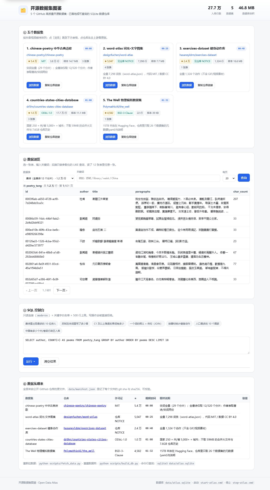

# 开源数据集图鉴 · Open Data Atlas

> 抖音视频《gitthub 上 5 个高质量的开源数据库》里的 5 个数据集，已**真下载、真入库、真能查**。
> 不是链接清单：`data/atlas.sqlite` 里躺着 **223,784 行**真实数据，配一个本地 Web 应用（浏览 + 搜索 + 只读 SQL 控制台）。

原视频：<https://www.douyin.com/video/7705208592323874111>（作者「特黑洞Lab」，时长 1:46）

---

## 一、这 5 个到底是什么

视频标题写"数据库"、字幕写"数据集"——实际是**数据集**。下表顺序与视频一致，`视频时间` 是我抽帧确认的出处位置。

| # | 数据集 | 视频 | 仓库 | ★ | 许可证 | 入库行数 |
|---|--------|------|------|---|--------|---------|
| 1 | 中华古典诗歌（唐诗/宋词） | 00:08 | [chinese-poetry/chinese-poetry](https://github.com/chinese-poetry/chinese-poetry) | 54,466 | MIT | 38,248 |
| 2 | 词光 · 文字图集（雅思 7,298 词） | 00:25 | [designfuchen/word-atlas](https://github.com/designfuchen/word-atlas) | 5,046 | MIT + CC BY 4.0 | 7,298 |
| 3 | 健身动作库（1,324 个动作） | 00:48 | [hasaneyldrm/exercises-dataset](https://github.com/hasaneyldrm/exercises-dataset) | 23,876 | 见仓库 NOTICE | 1,324 |
| 4 | 国家 / 州省 / 城市数据库 | 01:08 | [dr5hn/countries-states-cities-database](https://github.com/dr5hn/countries-states-cities-database) | 10,035 | ODbL-1.0 | 176,844 |
| 5 | The Well（15TB 物理模拟） | 01:32 | [PolymathicAI/the_well](https://github.com/PolymathicAI/the_well) | 4,582 | BSD-3-Clause | 22（元数据） |

各数据集的字段、取样范围、怎么拿全量，见 **[DATASETS.md](DATASETS.md)**。

---

## 二、三步跑起来

```bash
# 1) 拉数据（约 51MB，走 GitHub API，断点续传；重复运行会跳过没变的文件）
python scripts/fetch_data.py

# 2) 建库（产出 data/atlas.sqlite，约 46.8MB，12 张表）
python scripts/build_db.py

# 3) 起服务（Windows 双击 start-atlas.cmd 等价）
python scripts/serve.py
```

打开 <http://127.0.0.1:8790>，局域网访问 `http://192.168.1.16:8790`。

| 操作 | Windows |
|------|---------|
| 启动（隐藏窗口常驻，日志 `logs/atlas.log`） | 双击 `start-atlas.cmd` |
| 停止 | 双击 `stop-atlas.cmd` |
| 命令行查库 | `sqlite3 data/atlas.sqlite` |

> `.cmd` 文件必须是 **GBK/ANSI 编码**（中文系统下 cmd.exe 按 GBK 解析批处理，UTF-8 会把中文行拆坏）。脚本里已经注明。

---

## 三、应用里有什么



1. **五张数据集卡** — 星数、许可证、入库行数、样本体积、视频出处时间，一键跳到对应表。
2. **数据浏览** — 12 张表任选，关键词走参数化 `LIKE`，20/50/100 行分页。
3. **SQL 控制台** — 预置 7 条示例（含 JOIN），支持 `Ctrl/Cmd + Enter` 执行。
4. **数据从哪来** — 每个文件的 git sha + sha256 都记在 `data/manifest.json`，可校验。

只读边界（`scripts/serve.py`）：

- 数据库用 `file:...?mode=ro` 打开，**物理只读**；
- 只允许 `SELECT / WITH / EXPLAIN`，`DELETE/UPDATE/PRAGMA/ATTACH/…` 直接 400；
- 结果强制包一层 `LIMIT 500`，`set_progress_handler` 限制执行步数，慢查询自动中断。

---

## 四、目录结构

```
open-data-atlas/
├─ data/
│  ├─ raw/            # 原始样本（按数据集分目录，51MB，不入 Git）
│  ├─ atlas.sqlite    # 统一数据库（46.8MB，构建产物，不入 Git）
│  ├─ samples/        # 小样本 JSON，供 Pages 静态站使用
│  └─ manifest.json   # 来源 / git sha / sha256 / 字节数 / 抓取时间
├─ scripts/
│  ├─ fetch_data.py   # 抓取（GitHub Git Data API）
│  ├─ build_db.py     # 归一化入库 + 导出样本
│  ├─ serve.py        # 本地 Web + 只读 SQL 网关
│  ├─ verify.py       # 验收（18 项）
│  └─ publish_github.py # 发布到 GitHub Pages
├─ web/               # 单页应用（无框架、无 CDN）
├─ docs/              # GitHub Pages 静态站（含 SQL 练习）
├─ tests/             # 20 个 unittest（数据 + API）
├─ start-atlas.cmd / stop-atlas.cmd
└─ logs/              # 运行日志（自动生成）
```

---

## 五、数据库里长什么样

12 张表，按数据集前缀命名，方便练 SQL：

| 表 | 行数 | 说明 |
|----|------|------|
| `poetry_tang` | 12,003 | 《全唐诗》12/320 分片：作者、标题、正文、字数 |
| `poetry_ci` | 21,053 | 《宋词》全量 29 分片：作者、词牌、正文 |
| `poetry_authors` | 5,192 | 唐宋诗人小传 |
| `words` | 7,298 | 雅思词条：音标、CEFR、话题 |
| `words_senses` | 13,733 | 词义（中英释义），`word_id` 外键 |
| `words_examples` | 14,596 | 中英对照例句 |
| `words_collocations` | 24,722 | 固定搭配 |
| `ex_exercises` | 1,324 | 动作：部位、器材、目标肌群、英文要领 |
| `geo_countries` | 250 | 国家：ISO、首都、人口、面积、电话区号 |
| `geo_states` | 5,327 | 州/省：类型、经纬度、时区 |
| `geo_cities` | 171,267 | 城市 → 国家 |
| `well_datasets` | 22 | The Well 各数据集的维度/分辨率/场变量 |

```sql
-- 例：宋词里谁写得最多
SELECT author, COUNT(*) c FROM poetry_ci GROUP BY author ORDER BY c DESC LIMIT 5;

-- 例：一个词的释义 + 例句（三表 JOIN）
SELECT w.word, s.zh, e.en
FROM words w
JOIN words_senses s   ON s.word_id = w.word_id AND s.idx = 0
JOIN words_examples e ON e.word_id = w.word_id AND e.idx = 0
WHERE w.word = 'library';
```

更多练习：**[docs/sql-practice.html](docs/sql-practice.html)**（15 题，附答案与考点）。

---

## 六、验收

```bash
python -m unittest discover tests -v   # 20 个测试：表结构/内容抽样/API/只读边界
python scripts/verify.py               # 18 项验收：manifest 校验 + 服务 + SQL + 只读
```

当前状态：**20/20 测试通过，18/18 验收通过**。验收项包括 `manifest.json` 里 95 个文件的 SHA-256 全量比对。

---

## 七、样本 vs 全量（重要）

为了能放进一个可分享的仓库，本项目**只落地样本级数据**，每个数据集在 `DATASETS.md` 里都写清了"取了哪些、没取哪些"：

- 唐诗只取 12/320 个分片；宋词是全量；
- 城市表是 `countries+cities.json`（4.5MB，171,267 城），不取 59MB 的合并大文件；
- **The Well 的 15TB 本体不下载**，只入 22 个数据集的元数据，并给出 Hugging Face 获取方式；
- 健身动作不含 GIF/视频素材（原仓 125MB 主要是这两类）。

`python scripts/fetch_data.py --full` 预留了全量开关（实现里按 `limit` 控制）。

---

## 八、许可证与出处

代码 MIT。数据各自遵循上游许可证：MIT、CC BY 4.0、ODbL-1.0、BSD-3-Clause，以及 exercises-dataset 的 NOTICE（原仓为 NOASSERTION，需按仓库声明使用）。详见 [docs/licenses.html](docs/licenses.html) 与各数据集仓库。
